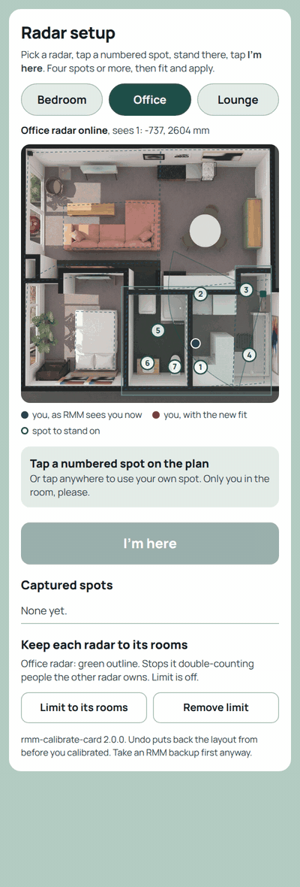
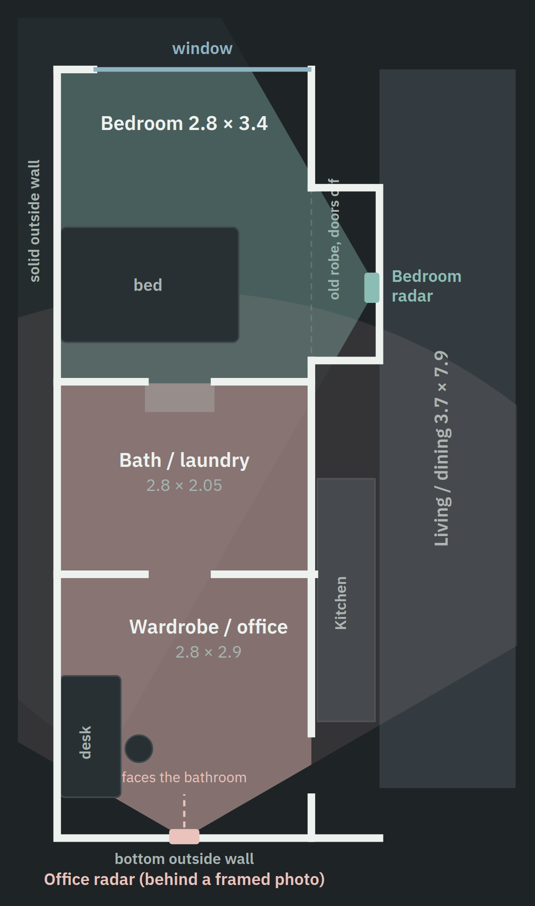
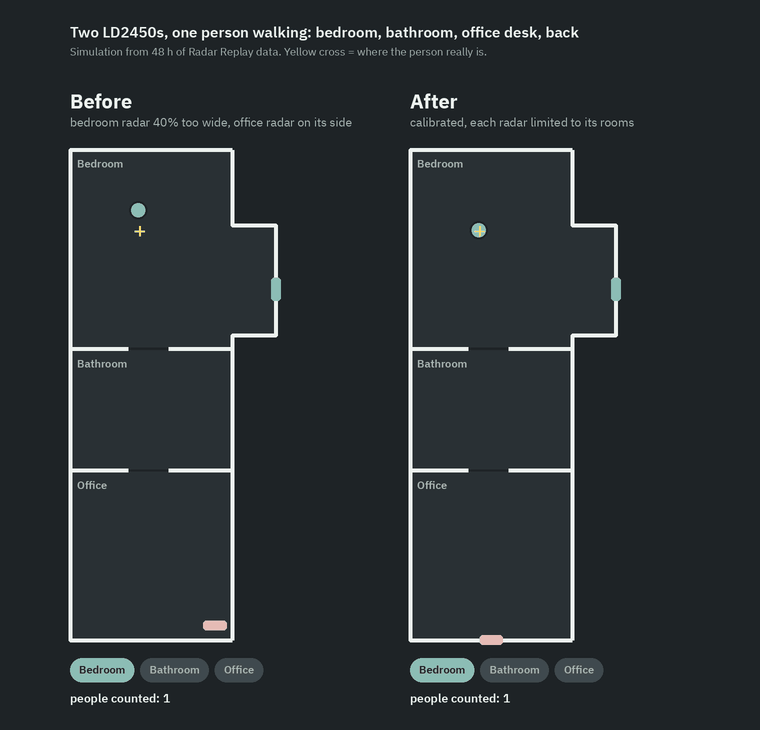
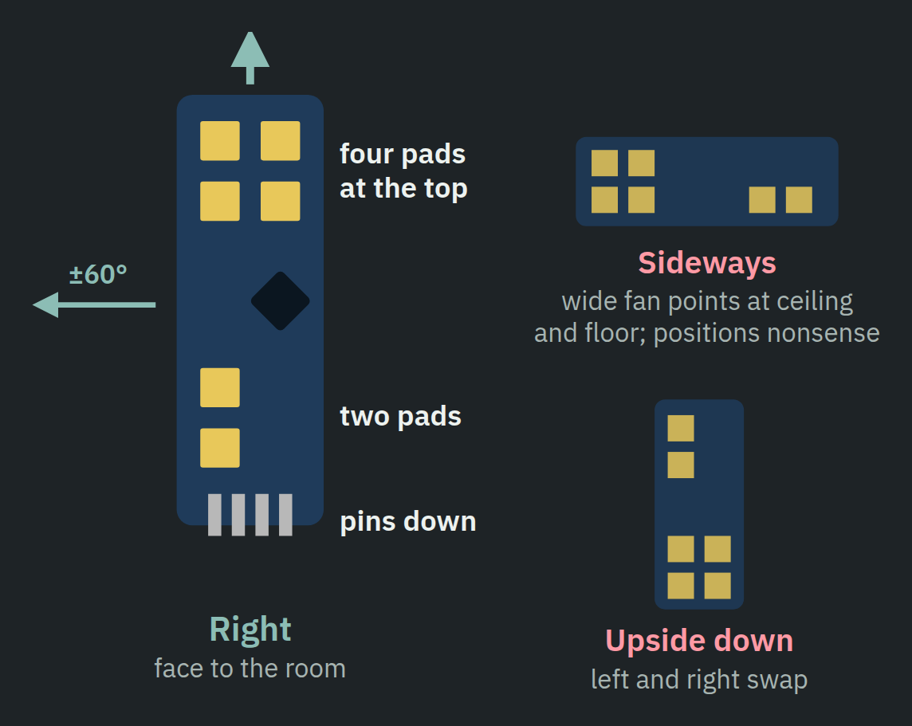
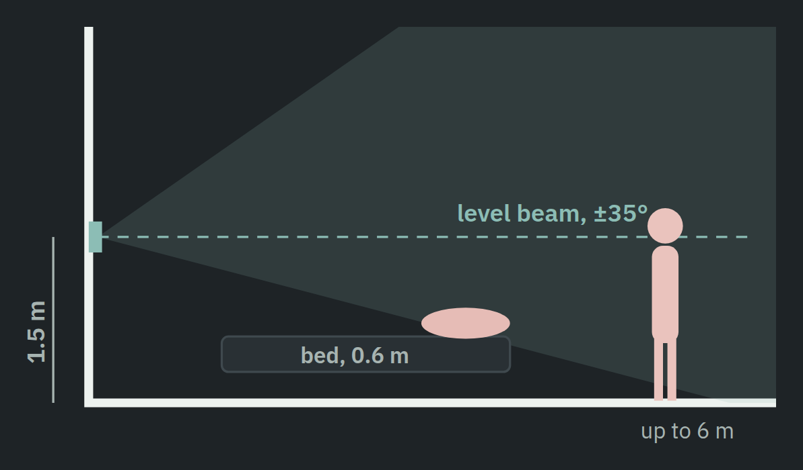
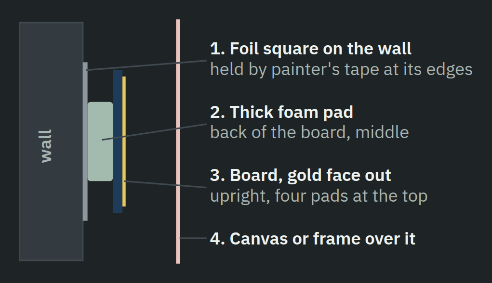
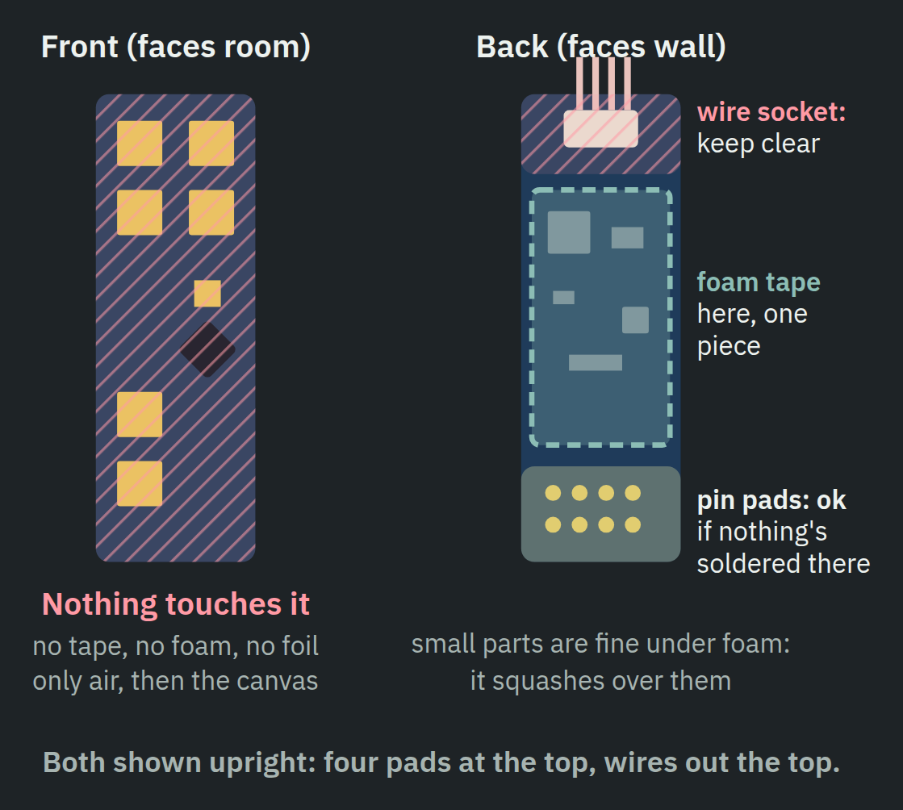
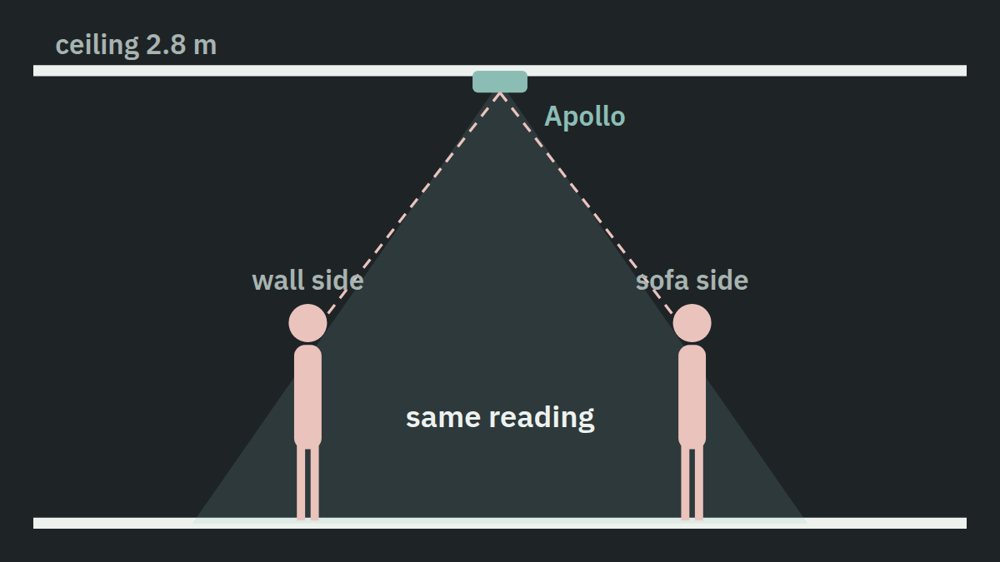
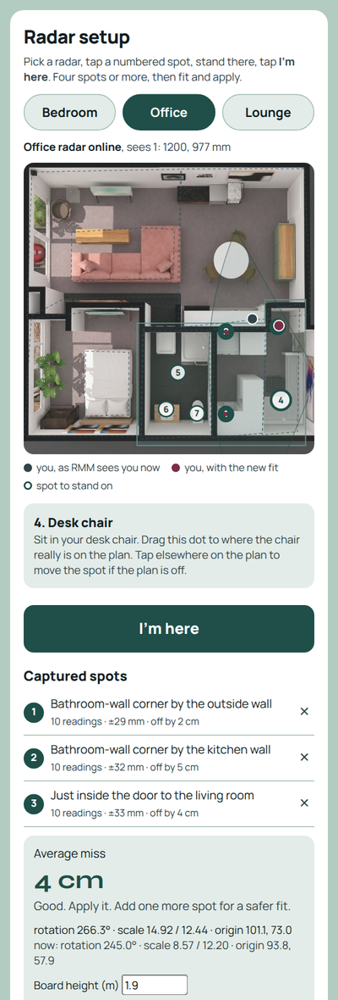
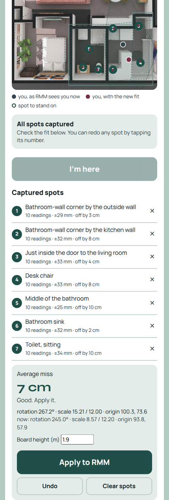

# Radar setup: calibrate LD2450s in Radar Map Manager by standing on spots

A small Home Assistant card for [Radar Map Manager](https://github.com/Moe8383/radar_map_manager) (RMM). Stand on a few marked spots on your floorplan, tap **I'm here** on your phone, and it works out each radar's position, rotation, scale and mirroring, then applies them to RMM. No tape measure, no guessing numbers in the card editor.

To be clear about where I started: it all already worked. RMM was set up and tracking, the zones drove my automations, and it was good enough day to day. But I never installed the radars properly. Boards taped up or dangling, one in a box, layouts hand-tuned by trial and error. This was about perfecting it in a few simple steps:

1. **Position it right:** a visual guide to where each radar goes, which way up, how high and where it points.
2. **Overlay it:** fit each radar onto the floorplan by standing on spots, not by typing numbers into the card editor.
3. **Let the fit absorb the rest:** mounting height, an odd angle, a floorplan that isn't to scale. All of it, in one easy multi-stop walk per radar.

Below the card is the write-up: what the data said was wrong, what the Hi-Link manual actually says about mounting (the vertical vs horizontal argument), and how the real room dimensions fed into it.

<p align="center"></p>

<sub>The card running against a simulated person. Live it looks the same, only slower because you walk.</sub>

---

## My setup

- **Radar Map Manager** (HACS) fusing three LD2450s onto one floorplan.
- **Lounge:** Apollo R PRO-1 in a ceiling light cover, looking straight down. It also carries an LD2412, which I use for "still there" detection, not position.
- **Bedroom and office:** two DIY trackers (ESP32 + bare LD2450), on RMM-aware firmware.
- **Radar Replay:** a panel I use that records 48 hours of RMM movement, so I can check things with data instead of vibes.
- About 25 automations hang off the RMM zones: lights, the night path to the bathroom, the shower hold, away mode, Sonos following me. When tracking is wrong, the house is wrong.

<p align="center"></p>

<sub>Drawn to scale from the real plan, 60 px = 1 m. Strong colour = what each radar is allowed to count. Faint = where its radio still reaches through walls.</sub>

## What "good enough" was hiding (48 hours of Radar Replay)

Day to day it looked fine. The data said otherwise. I checked each radar's raw points against the zones, and against two independent sensors: the bathroom's mmWave presence sensor and a bedroom PIR.

| | Before |
|---|---|
| Office radar's bathroom readings that matched the bathroom sensor | **85%** (it really does see through the wall) |
| Bedroom radar's bathroom readings that matched | **41%** (mostly me in the bedroom, drawn in the bathroom) |
| Median gap between the two radars' dots for the same person | **1.3 m** (RMM merges within 0.4 m, so: two people) |
| Bathroom zone on/off flips | **508**, 353 of them under 10 s |
| Time showing two of me in the bathroom area | **25 min** |

Causes, once I looked at the actual mounts:

- **The office radar was mounted on its side.** The board's long edge was horizontal, inside a box on a shelf. That turns the wide 120° view into an up-and-down view, and no amount of fiddling with rotation in RMM fixes that.
- **The bedroom radar's sideways scale was about 40% too big**, so standing on the bathroom side of the bedroom put me in the bathroom.
- **The bedroom radar dangled on its jumper wires.** A radar that swings sees the whole room moving.
- **Its "Wi-Fi dropouts" weren't the radar.** It went offline 92 times in a week, always in the same minute as the TV and Sonos on the same power board.

<p align="center"></p>

<sub><b>Simulation</b>, not a recording. "Before" reproduces the errors measured above; "after" is what a calibrated pair should do. I'll swap in a real Radar Replay clip once the trackers are re-seated.</sub>

## Using the real room dimensions

My HA floorplan is a pretty 3D render. It turned out to be **rotated 90° from the real plan and not to scale**: the bedrooms are stretched about 30% across. That matters, because RMM places a radar's targets with:

```
map = origin + rotate(rotation) · (x · scale_x, y · scale_y)      (x mirrored if mirror_x)
```

so `scale_x` and `scale_y` are "map units per metre" in the radar's own left-right and forward directions. On a distorted picture, the right values differ per radar and per axis. That's fine. What matters is that each person lands in the right zone *on that picture*.

Height gets absorbed the same way. An LD2450 measures straight-line distance to your chest, so a board at 1.8 m reads you a little further away than you are on the floor. RMM's LD2450 layout has no height correction, but the fitted scale soaks it up, because you stood on real spots at your real height.

So I used the real plan (2.8 × 3.4 m bedroom, 2.8 × 2.05 m bath, 2.8 × 2.9 m office, 3.7 × 7.9 m living) for the physical decisions: where to mount, what each radar can see, how far, and at what angle. Calibration then fits each radar to the picture HA actually shows, by standing on spots I can recognise on it (corners, doorways, the sink, the toilet, the desk chair). That's why the card asks you to stand on spots rather than type in measurements.

## Mounting: what the Hi-Link manual actually says

Forums argue about "vertical" vs "horizontal". The [Hi-Link LD2450 manual](https://cdn.shopify.com/s/files/1/0792/0959/5187/files/HLK-LD2450-Instruction-Manual.pdf?v=1712943888) settles it (section 7, Figure 6):

<p align="center"></p>

- **Long edge vertical, the four-pad end at the top, the pin header at the bottom, gold side facing the room.** Left-right is the wide ±60° view; up-down is ±35°.
- **The two camps are describing different things.** Forum "vertical" means the board stands upright on the wall. The manual's "horizontal" (Figure 5) means the *beam* goes out level across the room. Nobody means lay the board on its side.
- **Height 1.5 to 2 m, level** (Figure 5). Mine ended up at about 1.8 m above a TV. That's fine; tip it down 5 to 10° if you can.
- **Facing radars:** "do not install them in the direction directly opposite to the beam." Mine cross, they don't face each other.
- **Back lobe:** the manual says the radar can see motion *behind* it and suggests a metal back plate. Kitchen foil works.

<p align="center"></p>

### Hiding it behind a canvas or a framed photo

24 GHz goes through a fabric canvas, or a glassless frame with fibreboard backing, paper and photo paper, with little loss. Keep metal out of the way: no metallic paint, no mirror, no foil-backed mat. The manual's radome rule (gap a whole number of 6.2 mm half-wavelengths) matters for rigid covers. With fibreboard, I aim for about 6 mm of air.

The mount ended up dead simple:

<p align="center"> </p>

- **Thick double-sided foam pad** on the middle of the board's back. Foam is an insulator and squashes over the small parts. Keep the wire socket clear.
- **Foil square on the wall** under the foam, if something moves on the other side of that wall. The foam keeps it off the board.
- **Wi-Fi antenna** taped upright beside the board, off the foil and away from metal.
- **Its own USB charger**, not the TV's power board.

### Ceiling radars fold

An LD2450 looking straight down can't tell which side of it you're on across the room. In 48 hours my Apollo never read anyone closer than about 1.7 m, which is the drop from ceiling to chest. Along the room it's fine (readings run from −3 m to +3 m).

<p align="center"></p>

That's why "put the origin on the wall" works for so many people with ceiling mounts: it's the right straight-line stand-in for the fold, for the side of the room you actually use. To calibrate one, use spots on the side you live on, plus one right underneath it. The strip between the light and the near wall stays mirrored whatever you do, unless you tilt the board about 30° with a wedge.

## The card

<p align="center"> </p>

How it works:

1. **Pick a radar.** The card listens to RMM's own `rmm/stream`, so it sees the raw targets RMM sees.
2. **Tap a numbered spot**, or anywhere on the plan, then stand there and tap **I'm here**. It listens for 5 seconds and takes the median of the steadiest cluster. It ignores anyone else in view and tells you if it saw them.
3. **After three spots it fits** origin, rotation, `scale_x`, `scale_y` and mirroring by least squares. It sweeps rotation, solves the rest exactly for each angle, then refines to 0.1°. You get an "average miss" in cm and a per-spot miss, so a bad spot is obvious.
4. **Check-only spots** (`check: true`) show how far off a radar puts you without bending its fit. I use them for the bedroom radar at the sink and toilet, to confirm both radars agree in the bathroom.
5. **Apply to RMM** calls `radar_map_manager.update_radar_layout` with the full layout. **Undo** puts back the layout it saw before you started.
6. **Limit to its rooms** (optional) sets an RMM monitor zone for that radar. Its targets outside the outline are dropped, which is what stops two radars both counting you through a wall.

Install:

1. Copy `card/rmm-calibrate-card.js` to `/config/www/rmm-calibrate/`.
2. Add it as a dashboard resource: `/local/rmm-calibrate/rmm-calibrate-card.js`, type JavaScript module.
3. Add a card. With no `radars:` it lists every RMM radar, and you tap your own spots. With config you get named spots, room outlines and ceiling notes. See [`examples/dashboard.yaml`](examples/dashboard.yaml).

```yaml
type: custom:rmm-calibrate-card
image: /local/images/floorplan.png   # the same image your radar-map-card uses
radars:
  - name: ld2450_tracker_2           # RMM radar_name
    label: Office
    spots:
      - {x: 69.6, y: 86.2, t: "Bathroom-wall corner by the outside wall", d: "Half a metre out from both walls."}
      - {x: 49.0, y: 84.5, t: "Bathroom sink"}
    monitor: [[39,55],[83,55],[83,47],[97,47],[97,97],[39,97]]
```

Spot and outline coordinates are percentages of the floorplan image (0 to 100), the same units RMM uses. **Take an RMM backup first** (`tools/rmm_dump.py`); restoring is one `radar_map_manager.import_config` call.

## How easy was it?

The lounge Apollo took about five minutes: six spots, one tap. Before, my sofa dot sat off to one side. Now it lands on the seat I'm in.

| Apollo layout | origin | scale x / y | rotation |
|---|---|---|---|
| Before (hand-tuned) | 57.4, 8.2 | 13.3 / 13.7 | 180° |
| After (fitted) | 58.8, 11.3 | 12.1 / 12.1 | 182.9° |

The bedroom and office trackers get re-seated this weekend. I'll add their before/after numbers and a real Radar Replay clip here.

## Tools

- `tools/rmm_dump.py`: save the full RMM config through `rmm/stream` (it isn't in the normal HA APIs).
- `tools/analyse_replay.py`: where each radar's points land, and how often two radars disagree by more than the merge distance. Needs a Radar Replay log and a dump.
- `tools/make_demo_gif.py`: renders the simulated before/after GIF above.

## Gotchas I hit

- RMM's config lives in `.storage`. Read it with the WS command `rmm/stream` (the first frame is an empty result; the config is in the event frames). `rmm/subscribe_stream` proxies to a radar's own IP and will hang.
- In RMM 1.3.12, `update_radar_layout` merges the layout you send, but send the full layout anyway. Older versions dropped missing keys.
- Don't use the LD2450's own Detection/Filter regions with RMM: they clip tracks at the edges and break handoff. Use RMM monitor zones instead.
- Mirrors, metal shelves and a tall leaning mirror in front of a radar make ghosts. So does anything moving behind the wall it's stuck to.

## Credits

[Radar Map Manager](https://github.com/Moe8383/radar_map_manager) by Moe8383 does the real work; this card only feeds it better numbers. Mounting facts are from Hi-Link's LD2450 manual. Built with [Claude Code](https://claude.com/claude-code).

MIT licence.
